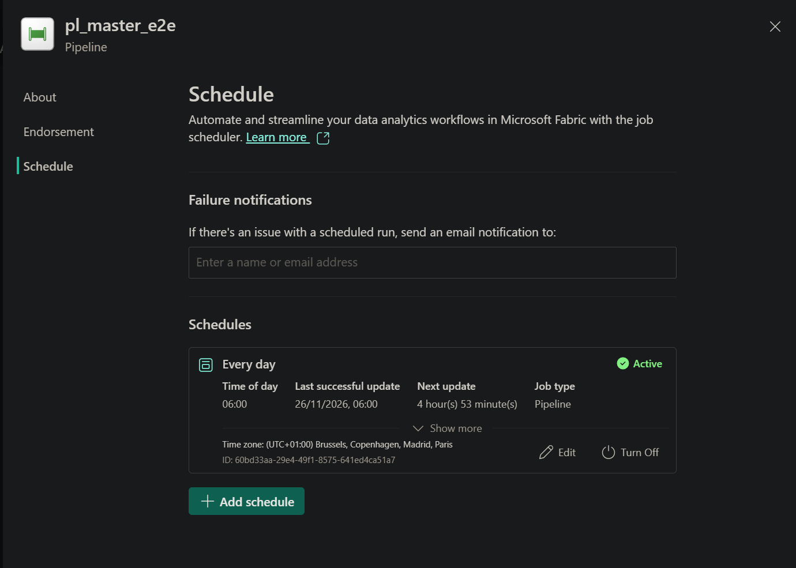
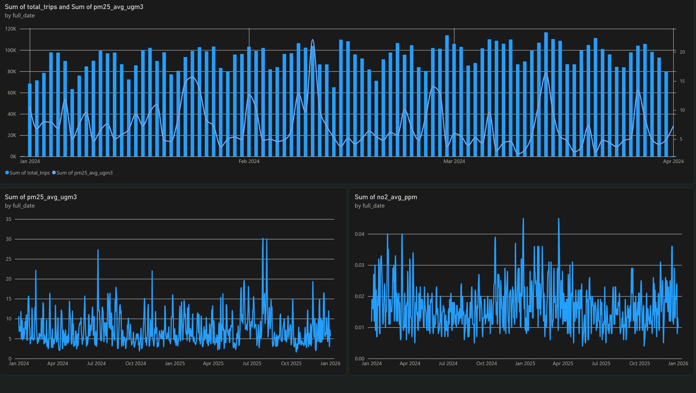

# Urban Analytics — Microsoft Fabric Data Engineering Platform

An end-to-end **Microsoft Fabric** data engineering project that turns four unrelated public
datasets into a single, governed analytical model. Raw data is ingested into a Bronze lakehouse,
cleansed and validated in a Silver lakehouse, and modelled into a **star schema** inside a Fabric
Warehouse (`UrbanAnalyticsWarehouse`) that feeds a Power BI semantic model and report.

The whole flow — ingestion, transformation, the data-quality gate and the warehouse load — is
orchestrated by a single master pipeline, `pl_master_e2e`.

---

## Table of contents

1. [Architecture](#architecture)
2. [Orchestration](#orchestration)
3. [Data sources](#data-sources)
4. [Medallion layers](#medallion-layers)
5. [Data quality gate](#data-quality-gate)
6. [Star schema in UrbanAnalyticsWarehouse](#star-schema-in-urbananalyticswarehouse)
7. [Data dictionary](#data-dictionary)
8. [Power BI reporting](#power-bi-reporting)
9. [Data governance policies](#data-governance-policies)
10. [Extensibility — how to add a new data source](#extensibility--how-to-add-a-new-data-source)
11. [Architectural decisions & trade-offs](#architectural-decisions--trade-offs)
12. [Repository structure](#repository-structure)
13. [Running the project](#running-the-project)
14. [Security notes](#security-notes)

---

## Architecture

The solution follows the **Medallion architecture** (Bronze → Silver → Gold) and separates
compute from storage: two lakehouses hold Delta tables, while a dedicated Fabric Warehouse holds
the dimensional model consumed by Power BI.

```
Public APIs / HTTP endpoints
        │
        ▼
┌──────────────────┐   ┌──────────────────┐   ┌────────────────────────┐
│ Lakehouse_Bronze │──▶│ Lakehouse_Silver │──▶│ UrbanAnalyticsWarehouse│
│  raw Delta/Files │   │ cleansed + DQ    │   │  star schema (T-SQL)   │
└──────────────────┘   └──────────────────┘   └───────────┬────────────┘
                                                         ▼
                                              UrbanAnalytics_SemanticModel
                                                         │
                                                         ▼
                                              UrbanAnalytics_Dashboard
```

The Fabric **lineage view** below shows the real dependency graph: HTTP sources and notebooks feed
`pl_master_ingest_bronze`, which writes to `Lakehouse_Bronze`; the transformation notebooks feed
`pl_master_transform_silver`, which writes to `Lakehouse_Silver`; `pl_master_load_gold` executes the
T-SQL procedures against the warehouse, and the semantic model / report sit downstream.


*Figure 1 — End-to-end lineage in Microsoft Fabric. Note the central position of
`nb_validate_data_quality` inside the Silver stage: no Gold table is loaded unless the quality gate
passes.*

---

## Orchestration

`pl_master_e2e` is the single entry point. It runs three child pipelines strictly in sequence, each
one gated on `Succeeded` of the previous activity:

| Stage | Pipeline | Activities |
|-------|----------|------------|
| 1. Bronze | `pl_master_ingest_bronze` | `Invoke_NYC_Taxi` → `Run_OpenAQ_Ingest` → `Run_GDP_Ingest` → `Run_FX_Ingest` → `Ingest_NYC_Zones` |
| 2. Silver | `pl_master_transform_silver` | `Transform_NYC_Taxi` → `Transform_OpenAQ` → `Transform_FX` → `Transform_GDP` |
| 3. Gold | `pl_master_load_gold` | `Load_Gold_Dimensions` → `Load_Gold_Fact_Taxi` and `Load_Gold_Air_Quality` (both after the dimensions) |

`pl_ingest_nyc_taxi` is a parameterised pipeline (`months_list`, default `["2024-01","2024-02","2024-03"]`)
that runs a **parallel ForEach** over the months and copies
`yellow_tripdata_<YYYY-MM>.parquet` from the NYC TLC CloudFront endpoint into
`Lakehouse_Bronze/Files/nyc_taxi`.

Because every stage is a separate child pipeline, a failure in the data-quality gate stops the run
before the warehouse is touched, and Fabric keeps per-activity status, duration and input/output for
each execution.


*Figure 2 — A successful end-to-end run of `pl_master_e2e`. All three stages completed and the Gold
warehouse was refreshed only after the Silver stage (including the DQ gate) finished successfully.
This run history is also the project's operational observability view: per-activity status, start
time, duration and input/output are the first place to look when a nightly load is late.*

### Scheduled refresh (Phase 5)

The platform is not only manually triggered. `pl_master_e2e` carries an **active daily schedule**:

| Setting | Value |
|---------|-------|
| Frequency | Every day |
| Time of day | **06:00** |
| Time zone | **(UTC+01:00) Brussels, Copenhagen, Madrid, Paris** |
| Job type | Pipeline |
| Status | **Active** |
| Schedule ID | `60bd33aa-29e4-49f1-8575-641ed4ca51a7` |

Each morning the scheduler runs the full Bronze → Silver → Gold chain, so the warehouse and the
Power BI report are refreshed before the working day starts. Because the DQ gate is part of the
Silver stage, a bad nightly load fails the run and leaves the previous Gold snapshot intact instead
of publishing corrupt numbers. Failure notifications can be routed to an email address from the same
Fabric schedule pane.



*Figure 3 — Phase 5: the daily 06:00 (UTC+01:00) schedule on `pl_master_e2e`. The scheduler replaces
manual runs as the normal operating mode; ad-hoc runs remain available for backfills and testing.*

---

## Data sources

| # | Source | API / endpoint | Granularity | Volume |
|---|--------|----------------|-------------|--------|
| 1 | **NYC TLC Yellow Taxi, Q1 2024** | `https://d37ci6vzurychx.cloudfront.net/trip-data/yellow_tripdata_2024-0{1,2,3}.parquet` | one row per trip | ≈ **9.55 M** raw rows → **8,576,986** cleaned trips in Gold |
| 2 | **OpenAQ v3 — NYC air quality** | `https://api.openaq.org/v3/locations` + `/v3/sensors/{id}/days` | daily averages per sensor (PM2.5, NO2) | 25 sensors max, 2024-01-01 → 2026-01-01 |
| 3 | **ECB — USD/EUR reference rate** | `https://data-api.ecb.europa.eu/service/data/EXR/D.USD.EUR.SP00.A?format=csvdata` | daily | ≈ 7.1 k daily observations |
| 4 | **World Bank — US GDP** | `https://api.worldbank.org/v2/country/USA/indicator/NY.GDP.MKTP.CD` | yearly | 66 annual observations |
| 5 | **NYC TLC taxi zone lookup** | `https://d37ci6vzurychx.cloudfront.net/misc/taxi_zone_lookup.csv` | one row per zone | 265 zones |

All sources are **public and key-less**, except OpenAQ v3, which requires an API key
(see [Security notes](#security-notes)).

---

## Medallion layers

### Bronze — `Lakehouse_Bronze`

Raw, append-only landing zone. Data is stored as-is, in Delta where a schema is useful and as
Parquet files where the source is a file drop:

| Object | Format | Written by |
|--------|--------|-----------|
| `Files/nyc_taxi/yellow_tripdata_2024-0*.parquet` | Parquet (binary copy) | `pl_ingest_nyc_taxi` |
| `Tables/dbo/openaq_locations_bronze` | Delta | `nb_ingest_openaq` |
| `Tables/dbo/openaq_measurements_bronze` | Delta | `nb_ingest_openaq` |
| `Tables/dbo/gdp_bronze` | Delta | `nb_ingest_gdp` |
| `Tables/dbo/fx_usd_eur_bronze` | Delta | `nb_ingest_fx` |
| `Tables/dbo/nyc_taxi_zones_bronze` | Delta | `nb_ingest_zones` |

Notebooks use `requests` + `pandas`/`json` for extraction and write with
`mode("overwrite").option("overwriteSchema", "true")`, so a re-run always produces a clean,
reproducible snapshot. The OpenAQ notebook handles HTTP 429 with a retry/back-off and caps the
number of queried sensors (`MAX_SENSORS_TO_FETCH = 25`) to stay inside API rate limits.

### Silver — `Lakehouse_Silver`

Conformed, typed and de-duplicated Delta tables — the single source of truth for the warehouse:

| Table | Key transformations |
|-------|---------------------|
| `nyc_taxi_silver` | lowercase schema, timestamp casting, `trip_duration_minutes`, filters (duration 0–1440 min, `fare_amount > 0`, `total_amount > 0`, `passenger_count > 0`, pickup year 2020–2026), derived `pickup_date` / `pickup_year` / `pickup_month` / `pickup_hour`, `dropDuplicates()`. Zero-distance trips are **kept on purpose** (waiting time / cancellation charges). |
| `openaq_silver` | `explode_outer(sensors)` to flatten station + sensor metadata into one dimension-ready table; casts, coordinate and parameter renaming, `dropDuplicates(["location_id","sensor_id"])`. |
| `openaq_measurements_silver` | date parsing + `date_key` (`yyyyMMdd`), lowercase parameter names, outlier filter (`0 ≤ avg_value < 1000`), de-duplication per sensor/day, then aggregation to one row per day × parameter with `daily_avg/min/max_value` and `active_sensors_count`. |
| `fx_usd_eur_silver` | date parsing from `TIME_PERIOD`, `exchange_rate` cast, positive-rate filter, de-duplication on `(rate_date, currency, currency_denom)`. |
| `gdp_silver` | flattening of the World Bank JSON envelope into `country_iso3`, `year`, `gdp_usd`, de-duplicated per country/year. |
| `nyc_taxi_zones_silver` | trimmed `borough` / `zone_name` / `service_zone`, integer `location_id`, de-duplicated. |

### Gold — `UrbanAnalyticsWarehouse`

A Fabric **Warehouse** (T-SQL, not Spark) that reads the Silver Delta tables through cross-database
three-part names (`[Lakehouse_Silver].[dbo].[...]`) and materialises the star schema. Everything is
created or refreshed by stored procedures, so a Gold reload is a single `EXEC`.

---

## Data quality gate

`nb_validate_data_quality` runs as the last step of the Silver stage (it is also `%run` from
`nb_transform_gdp`). It implements a small, dependency-free expectations framework —
`SilverQualitySuite` — with five reusable checks:

| Check | Purpose |
|-------|---------|
| `expect_row_count_between(min, max)` | catches empty loads and duplicated appends |
| `expect_not_null(col, mostly)` | completeness of key columns |
| `expect_between(col, min, max, mostly)` | range/outlier control (distances, amounts, hours, rates) |
| `expect_in_set(col, allowed)` | domain checks (e.g. `parameter_name ∈ {pm25, no2}`, `country_iso3 = USA`) |
| `expect_unique(col)` | primary-key sanity (e.g. `dim_zone.location_id`) |

Rules are applied to all five Silver tables, for example:

* `nyc_taxi_silver`: 1 M – 50 M rows, `pickup_date` not null, `trip_distance` 0–500 mi,
  `total_amount` 0.01–5 000 USD, `pickup_hour` 0–23.
* `openaq_measurements_silver`: 100 – 100 000 rows, `parameter_name ∈ {pm25, no2}`,
  `daily_avg_value` 0–1 000.
* `fx_usd_eur_silver`: `exchange_rate` between 0.5 and 2.5.
* `gdp_silver`: `country_iso3 = USA`, `gdp_usd` between 1e11 and 1e14.
* `nyc_taxi_zones_silver`: 260–270 rows, unique `location_id`.

Every run appends one row per table to the audit Delta table **`data_quality_logs`**
(`run_timestamp_utc`, `table_name`, `validation_passed`, `evaluated/successful/failed_expectations`,
`details_json`). The notebook then:

1. optionally posts a PASSED/FAILED notification to a Discord/Teams webhook (`webhook_url`),
2. raises `RuntimeError` when `fail_pipeline_on_error = True` and any expectation failed — which
   fails the Silver activity and therefore prevents `pl_master_load_gold` from running.


*Figure 4 — The `data_quality_logs` audit table. Historical runs are visible side by side, including
the earlier runs where `nyc_taxi_silver` and `nyc_taxi_zones_silver` failed, and the later green runs
where all five suites passed. The `details_json` column keeps the full expectation output for
traceability.*

---

## Star schema in UrbanAnalyticsWarehouse

The Gold model is a classic **star schema**: conformed dimensions shared by two fact tables
(taxi mobility and daily air quality), enriched with macro-economic context.

**Dimensions**

| Table | Grain | Source |
|-------|-------|--------|
| `dim_date` | one row per calendar date | union of taxi pickup dates, FX rate dates and air-quality measurement dates |
| `dim_zone` | one row per NYC TLC taxi zone | `nyc_taxi_zones_silver` |
| `dim_fx_daily` | one row per date, USD per EUR | `fx_usd_eur_silver`, weekend/holiday gaps forward-filled with a `LAST_VALUE`-style window (`COUNT` grouping + `MAX`) |
| `dim_gdp_yearly` | one row per year | `gdp_silver` |
| `dim_air_quality_sensors` | one row per sensor | `openaq_silver` |

**Facts**

| Table | Grain | Highlights |
|-------|-------|-----------|
| `fact_taxi_trips` | one row per trip | surrogate `date_key`, `gdp_year`, pickup/dropoff, vendor, PU/DO zone, payment type, distance, duration, fare/tip/total in USD **and** `total_amount_eur` converted at the daily ECB rate |
| `fact_taxi_daily` | one row per day | `total_trips`, `total_passengers`, distance and duration averages, revenue USD/EUR, FX rate |
| `fact_air_quality_daily` | one row per day | pivoted PM2.5 and NO2 average/min/max plus active sensor counts |

**Stored procedures** (T-SQL, in `sql/`)

| Procedure | Refreshes |
|-----------|-----------|
| `usp_load_gold_dimensions` | `dim_date`, `dim_zone`, `dim_fx_daily`, `dim_gdp_yearly`, `dim_air_quality_sensors` |
| `usp_load_gold_fact_taxi` | `fact_taxi_trips`, `fact_taxi_daily` |
| `usp_load_gold_air_quality` | `fact_air_quality_daily` |

Each procedure drops and recreates its target tables (`CREATE TABLE … AS SELECT`), which makes the
Gold layer fully idempotent and safe to re-run.


*Figure 5 — The warehouse object tree: five `dim_*` tables, three `fact_*` tables, the stored
procedures, and the numbered DDL scripts kept as reusable queries in the Fabric SQL editor.*

---

## Data dictionary

The dictionary below is derived directly from the `CREATE TABLE … AS SELECT` definitions in
`sql/01`–`sql/05`. Data types are the ones Fabric infers for the CTAS statements: Spark `double`
becomes `float`, Spark `bigint` becomes `bigint`, Spark `date`/`timestamp` become `date`/`datetime2`,
and strings become `varchar`. Because every Gold table is created with `CREATE TABLE … AS SELECT`,
**no physical PRIMARY KEY / FOREIGN KEY constraints are declared** — the keys listed below are
logical keys used by the Power BI model and by the loading procedures, and must be enforced by the
DQ gate plus the `dropDuplicates()` logic in Silver.

### `dim_date` — conformed calendar dimension

| Column | Type | Key | Business meaning |
|--------|------|-----|------------------|
| `date_key` | `int` | **PK** | Surrogate date key in `YYYYMMDD` form (e.g. `20240229`); the join key for every fact table. |
| `full_date` | `date` | | Calendar date. Union of taxi pickup dates, ECB rate dates and OpenAQ measurement dates. |
| `year` | `int` | | Calendar year (used to link trips to annual GDP context). |
| `month` | `int` | | Calendar month number 1–12. |
| `month_name` | `varchar(20)` | | English month name for report labels and sorting. |
| `day` | `int` | | Day of month 1–31. |
| `day_of_week` | `int` | | Day of week as returned by `DATEPART(WEEKDAY, …)`; used for weekday/weekend analysis. |
| `day_name` | `varchar(20)` | | English weekday name. |
| `is_weekend` | `int` | | `1` for Saturday/Sunday, `0` otherwise; drives weekend demand comparisons. |

### `dim_zone` — NYC TLC taxi zones

| Column | Type | Key | Business meaning |
|--------|------|-----|------------------|
| `location_id` | `int` | **PK** | Official TLC `LocationID` (1–265); joins to `pu_location_id` / `do_location_id`. |
| `borough` | `varchar` | | Borough of the zone (Manhattan, Brooklyn, Queens, Bronx, Staten Island, EWR, Unknown). |
| `zone_name` | `varchar` | | Human-readable zone name, e.g. `Upper East Side North`. |
| `service_zone` | `varchar` | | Service classification (`Yellow Zone`, `Boro Zone`, `Airports`, …). |

### `dim_fx_daily` — daily USD/EUR reference rate

| Column | Type | Key | Business meaning |
|--------|------|-----|------------------|
| `date_key` | `int` | **PK**, FK → `dim_date` | Date key (`YYYYMMDD`). |
| `rate_date` | `date` | | Calendar date of the observation. |
| `usd_per_eur_rate` | `float` | | ECB reference rate: how many USD one EUR buys. Weekend/holiday gaps are forward-filled with the last known rate, so every date in `dim_date` has a usable rate. |

### `dim_gdp_yearly` — US GDP by year

| Column | Type | Key | Business meaning |
|--------|------|-----|------------------|
| `gdp_year` | `int` | **PK** | Calendar year of the World Bank observation; joins to `fact_taxi_trips.gdp_year` / `fact_taxi_daily.gdp_year`. |
| `country_iso3` | `varchar(3)` | | ISO-3166 alpha-3 country code (`USA`). |
| `country_name` | `varchar` | | Country name as returned by the World Bank. |
| `indicator_id` | `varchar` | | World Bank indicator code (`NY.GDP.MKTP.CD` = GDP at current market prices, USD). |
| `indicator_name` | `varchar` | | Human-readable indicator description. |
| `gdp_usd` | `float` | | Annual US GDP in current US dollars; provides the macro-economic context for each trip year. |

### `dim_air_quality_sensors` — OpenAQ stations and sensors

| Column | Type | Key | Business meaning |
|--------|------|-----|------------------|
| `sensor_id` | `bigint` | **PK** | OpenAQ sensor identifier; one row per physical sensor. |
| `location_id` | `bigint` | | OpenAQ monitoring-station identifier (a station can host several sensors). |
| `location_name` | `varchar` | | Station name, e.g. a school or park in NYC. |
| `country_code` | `varchar` | | ISO country code of the station (`US`). |
| `country_name` | `varchar` | | Country name. |
| `latitude` | `float` | | Station latitude (WGS84). |
| `longitude` | `float` | | Station longitude (WGS84). |
| `parameter_name` | `varchar` | | Machine-readable measured parameter (`pm25`, `no2`, `pm10`, `o3`, …). |
| `parameter_display_name` | `varchar` | | Display label used on the Power BI sensor-inventory chart (`PM2.5`, `NO2`, …). |
| `parameter_units` | `varchar` | | Unit of measure (`µg/m³` for PM2.5, `ppm` for NO2). |
| `provider_name` | `varchar` | | Organisation providing the measurements. |
| `is_monitor` | `bit` | | `1` for reference-grade monitors, `0` for low-cost sensors — a proxy for measurement reliability. |

### `fact_taxi_trips` — trip-level fact

| Column | Type | Key | Business meaning |
|--------|------|-----|------------------|
| `date_key` | `int` | FK → `dim_date` | Pickup date key (`YYYYMMDD`). |
| `gdp_year` | `int` | FK → `dim_gdp_yearly` | Pickup year, used to attach annual GDP context. |
| `pickup_datetime` | `datetime2` | | Meter-activated pickup timestamp. |
| `dropoff_datetime` | `datetime2` | | Meter-disabled drop-off timestamp. |
| `pickup_hour` | `int` | | Hour of day 0–23; drives the hourly revenue profile. |
| `vendor_id` | `bigint` | | TLC TPEP provider code. |
| `pu_location_id` | `bigint` | FK → `dim_zone` | Pickup taxi zone. |
| `do_location_id` | `bigint` | FK → `dim_zone` | Drop-off taxi zone. |
| `payment_type` | `bigint` | | Payment method code (1 = credit card, 2 = cash, …). |
| `passenger_count` | `bigint` | | Number of passengers reported by the driver. |
| `trip_distance_miles` | `float` | | Trip distance in miles (TLC meter value; zero-distance trips are retained for waiting/cancellation charges). |
| `trip_duration_minutes` | `float` | | Drop-off minus pickup in minutes; filtered to `0 < duration < 1440`. |
| `fare_amount_usd` | `float` | | Metered fare in USD. |
| `tip_amount_usd` | `float` | | Tip in USD (only reliably captured for card payments). |
| `total_amount_usd` | `float` | | Total charged amount in USD, including taxes and surcharges. |
| `usd_per_eur_rate` | `float` | | ECB rate applied to the trip (denormalised from `dim_fx_daily` for convenience). |
| `total_amount_eur` | `float` | | `total_amount_usd / usd_per_eur_rate`, rounded to 2 decimals — the EUR-converted revenue. |

### `fact_taxi_daily` — daily taxi aggregates

| Column | Type | Key | Business meaning |
|--------|------|-----|------------------|
| `date_key` | `int` | **PK** (with `gdp_year`), FK → `dim_date` | Aggregation date. |
| `gdp_year` | `int` | **PK** (with `date_key`), FK → `dim_gdp_yearly` | Year of the aggregation date. |
| `total_trips` | `bigint` | | Number of trips completed that day. |
| `total_passengers` | `bigint` | | Sum of `passenger_count`. |
| `total_distance_miles` | `float` | | Sum of trip distances. |
| `avg_distance_miles` | `float` | | Average trip distance (3.45 mi across Q1 2024). |
| `avg_duration_minutes` | `float` | | Average trip duration. |
| `total_fare_usd` | `float` | | Sum of metered fares. |
| `avg_fare_usd` | `float` | | Average fare per trip (18.97 USD across Q1 2024). |
| `total_tip_usd` | `float` | | Sum of tips. |
| `total_revenue_usd` | `float` | | Sum of total charged amounts. |
| `usd_per_eur_rate` | `float` | | ECB rate for that day. |
| `total_revenue_eur` | `float` | | Daily revenue converted to EUR. |

### `fact_air_quality_daily` — daily air-quality fact

| Column | Type | Key | Business meaning |
|--------|------|-----|------------------|
| `date_key` | `int` | **PK**, FK → `dim_date` | Measurement date key (`YYYYMMDD`). |
| `measurement_date` | `date` | | Calendar date of the daily aggregate (kept for readability and range filtering). |
| `pm25_avg_ugm3` | `float` | | City-wide average PM2.5 concentration for the day, µg/m³. |
| `pm25_min_ugm3` | `float` | | Lowest station-level PM2.5 average of the day. |
| `pm25_max_ugm3` | `float` | | Highest station-level PM2.5 average of the day. |
| `pm25_sensors_count` | `int` | | Number of PM2.5 sensors that reported on that day (data-coverage indicator). |
| `no2_avg_ppm` | `float` | | City-wide average NO2 concentration for the day, ppm. |
| `no2_min_ppm` | `float` | | Lowest station-level NO2 average of the day. |
| `no2_max_ppm` | `float` | | Highest station-level NO2 average of the day. |
| `no2_sensors_count` | `int` | | Number of NO2 sensors that reported on that day. |

### Relationships

```
dim_date ──1:N── fact_taxi_trips        dim_zone ──1:N── fact_taxi_trips (pickup / drop-off)
   │                                     dim_fx_daily ──1:N── fact_taxi_trips (rate attribute)
   ├──1:N── fact_taxi_daily
   └──1:N── fact_air_quality_daily       dim_gdp_yearly ──1:N── fact_taxi_daily
                                         dim_air_quality_sensors ──(descriptive)── fact_air_quality_daily
```

---

## Power BI reporting

`UrbanAnalytics_SemanticModel` is a Direct Lake / import model over the star schema; the report
`UrbanAnalytics_Dashboard` has **four analytical pages**, exported here as screenshots
(`reports/UrbanAnalytics_Dashboard.pdf` contains the same report as a PDF). Operational evidence —
the pipeline run history — is documented in [Orchestration](#orchestration) instead.

### Page 1 — Mobility overview

Daily trip volume for Q1 2024, revenue distribution by hour of day, the top pickup zones and the
headline KPIs: average fare **18.97 USD**, average trip distance **3.45 mi**, **9 M** trips and
**238.93 M USD** of revenue.


*Figure 6 — Demand is strongly bimodal (morning and evening commute peaks), and Manhattan's Upper
East Side / Midtown zones dominate pickup volume.*

### Page 2 — Mobility vs. air quality

A combo chart overlays daily trips (bars) with daily PM2.5 (line), and two trend charts show PM2.5
and NO2 across the full 2024 → 2026 measurement window, which makes it possible to compare weekday
traffic cycles with pollution episodes.



*Figure 7 — Taxi demand and PM2.5 move on the same weekly rhythm, while NO2 stays in a narrow
0.01–0.04 ppm band with occasional spikes.*

### Page 3 — Revenue in two currencies

Total revenue in USD and EUR follows the ECB USD/EUR reference rate, so the currency effect is
visible directly on the revenue line; the second chart plots the daily exchange rate itself.


*Figure 8 — The USD/EUR gap on the revenue lines widens exactly where the ECB rate moves, proving
the FX join and the forward-fill logic in `dim_fx_daily`.*

### Page 4 — Macro context and sensor inventory

US GDP by year (1960 → 2025, in USD trillions) alongside the sensor inventory of the air-quality
dimension, broken down by measured parameter.


*Figure 9 — `dim_gdp_yearly` gives every taxi trip a macro-economic context year, and
`dim_air_quality_sensors` documents exactly which parameters the NYC stations report.*

---

## Data governance policies

### Access control — Fabric workspace RBAC

Access is granted through **Fabric workspace roles**, not through ad-hoc table grants, so a single
role change covers notebooks, pipelines, lakehouses, the warehouse and the semantic model.

| Role | Who | Effective permissions |
|------|-----|-----------------------|
| **Admin** | Platform owner (1–2 people) | Full control: manage workspace, members, connections, schedules and capacity settings; can delete items and rotate credentials. |
| **Member** | Data engineers | Create/edit notebooks, pipelines and SQL objects; run `pl_master_e2e`; read and write all lakehouses and the warehouse. Cannot manage workspace membership. |
| **Contributor** | Senior analysts / reviewers | Publish and edit content and run pipelines, but no member management. Intended for temporary collaboration. |
| **Viewer** | Business users, report consumers | Read-only: view the report and semantic model, query the warehouse with `ReadData` only. No writes to Bronze/Silver/Gold and no pipeline execution. |

Additional rules:

* Row-level security and object-level security, if ever needed, are implemented in the
  **semantic model** (`UrbanAnalytics_SemanticModel`) rather than duplicated per table.
* Service principals used for scheduled runs are granted **Member** only on this workspace and are
  scoped to it; no tenant-wide permissions.
* Joining/leaving a project is handled by role assignment — individual table grants are avoided so
  that the permission model stays auditable.

### Data classification and PII

| Dataset | Classification | PII | Rationale |
|---------|----------------|-----|-----------|
| NYC TLC Yellow Taxi (Bronze/Silver/Gold) | **Public** (source) / **Internal** (curated) | **None** | The TLC release is already anonymised: no passenger or driver identifiers, no names, no card numbers, no addresses — only timestamps, zone IDs, payment-type codes and amounts. |
| OpenAQ v3 air quality | **Public** (source) / **Internal** (curated) | **None** | Station metadata (name, coordinates, provider) and environmental measurements only. |
| ECB USD/EUR rates | **Public** | **None** | Published reference rates. |
| World Bank US GDP | **Public** | **None** | Published macro-economic indicator. |
| `data_quality_logs` | **Internal** | **None** | Contains table names, row counts and rule outcomes; `details_json` holds only rule metadata, never row-level values. |
| Power BI report / semantic model | **Internal** | **None** | Aggregated business metrics. |

Consequences of this classification:

* **No PII is ingested, so no GDPR subject-rights workflows (export/erasure) are required.** This is
  a deliberate design constraint: if a future source introduces personal data, it must be
  pseudonymised in Bronze and the classification table above must be updated before the source is
  promoted to Silver.
* **Public sources ≠ public output.** The curated warehouse, audit logs and report are **Internal**:
  visible only inside the Fabric tenant, never published anonymously.
* Coordinates are station-level (public infrastructure), not device-level, so they do not enable
  individual tracking.

### Retention of audit logs (`data_quality_logs`)

* `data_quality_logs` is **append-only**; nothing in the pipeline updates or deletes historical rows.
* Retention: **12 months hot** in the lakehouse for trend analysis and incident review; older
  partitions are exported to an archive location (OneLake folder or storage account) and removed
  from the live table. The archive keeps the same schema, so historical audits remain queryable.
* Each run adds **one row per validated table** (five rows per full refresh), so volume is tiny
  (≈ 1 800 rows/year) and the retention job is cheap.
* `details_json` is truncated to 4 000 characters by the notebook, which bounds row size while
  keeping the failing rule visible.
* The log table itself is never used as a source for Gold — deleting old rows cannot affect the
  warehouse or the report.

### Secrets management

* **No secret is stored in this repository.** `OPENAQ_API_KEY` is the literal placeholder
  `"YOUR_API_KEY"`; the remaining sources need no credentials.
* At runtime the key is injected from **outside** the code: a Fabric **variable library**, a
  **Key Vault-backed connection**, or an environment variable read inside the notebook. The value is
  never printed and never written into cell outputs.
* Keys are rotated on a schedule and on any suspected exposure; the notebook only reads the value,
  so rotation requires no code change.
* `.gitignore` excludes `.env` / `.env.*` and notebook checkpoints, and commits are scanned for
  token-like strings before they are pushed.
* Workspace connections (HTTP, Lakehouse) are stored as Fabric connections with their own
  credential handling — they are not embedded in the pipeline JSON files.

---

## Extensibility — how to add a new data source

The pipeline is deliberately uniform: **one ingest notebook per source, one transform notebook per
source, one block of expectations, one procedure per fact/dimension group**. Adding a source follows
the same five steps.

1. **Ingest into Bronze** — create `notebooks/nb_ingest_<source>.ipynb`. Read `workspace_id` /
   `bronze_lakehouse_id`, fetch the data with `requests` (add retry/back-off for `429`, pagination and
   a hard cap on pages/sensors as done for OpenAQ), convert to Spark and write a Delta table
   `Tables/dbo/<source>_bronze` with
   `mode("overwrite").option("overwriteSchema", "true")`.
2. **Wire it into orchestration** — add a notebook activity to
   `pipelines/pl_master_ingest_bronze.json` (e.g. `Run_<Source>_Ingest`) with
   `dependsOn` → `Succeeded` of the previous activity, so the Bronze stage stays strictly sequential
   and the new source cannot be skipped silently.
3. **Transform to Silver and register quality rules** — create
   `notebooks/nb_transform_<source>.ipynb` that reads the Bronze table, applies typing, filtering and
   `dropDuplicates()`, and writes `<source>_silver` as a Delta table. Then open
   `nb_validate_data_quality` and add a `SilverQualitySuite("<source>_silver")` block with at least
   `expect_row_count_between`, `expect_not_null` on the business key and `expect_between` /
   `expect_in_set` on the main measures. Add the suite to the `all_passed = all([...])` expression so
   the gate blocks Gold on failure.
4. **Extend the Gold model** — add the T-SQL in `sql/` (new `dim_*` / `fact_*` table, plus
   `CREATE OR ALTER PROCEDURE dbo.usp_load_gold_<source>`), register the procedure as a
   `SqlServerStoredProcedure` activity in `pipelines/pl_master_load_gold.json`, and document every
   column in the [Data dictionary](#data-dictionary).
5. **Refresh the semantic model** — add the table to `UrbanAnalytics_SemanticModel`, define the
   relationships to `dim_date` (and other conformed dimensions), add measures, then refresh and
   extend the report. Finally, update this README (data sources, medallion tables, dictionary) and
   run `pl_master_e2e` end-to-end to confirm the new source passes the gate.

---

## Architectural decisions & trade-offs

### a) PySpark notebooks instead of Dataflow Gen2

Dataflow Gen2 is excellent for GUI-driven, low-code transformations, but it is a poor fit for these
APIs, so the Silver layer is implemented in **PySpark notebooks**:

* **Rate limits need imperative logic.** OpenAQ v3 answers `429 Too Many Requests`; the notebook
  handles it with an explicit `sleep` + retry, a per-request delay (`time.sleep(0.25)`) and a cap of
  `MAX_SENSORS_TO_FETCH = 25`. Expressing that control flow reliably in a Dataflow Gen2 query is
  awkward; in Python it is a few lines.
* **Nested JSON must be flattened.** OpenAQ station payloads nest `sensors[]`, `coordinates`,
  `country`, `provider` and `owner`. `explode_outer` + dotted column access is natural in Spark and
  keeps the flattening explicit and testable.
* **One language end-to-end.** Ingestion, transformation, the DQ framework and the audit log are all
  Python/PySpark, so helpers such as `SilverQualitySuite` can be shared across notebooks and the
  logic is reviewable in code review like any other source file.
* **Trade-off accepted:** more code to maintain than a visual dataflow, and Spark session start-up
  latency (≈ 1–2 min per notebook). In exchange the pipeline is versionable, diffable and handles
  API quirks deterministically.

### b) NYC Taxi scoped to Q1 2024, with a fully parameterised pipeline

`pl_ingest_nyc_taxi` accepts a `months_list` parameter (default `["2024-01","2024-02","2024-03"]`),
so the ingestion is **not hard-coded to three months** — any month range can be backfilled by
changing one parameter. The committed default is intentionally limited to **Q1 2024 (8 576 986
cleaned trips)**:

* Loading years of TLC Parquet files would exceed **Fabric Trial capacity limits**; the platform
  answers with **HTTP 430 / capacity throttling**, which turns a demo into a failed run.
* Three months are enough to demonstrate every pattern the project needs: daily seasonality, hourly
  peaks, zone concentration, currency conversion and the air-quality join.
* The **long time horizon is provided by the dimensions instead of the fact table**: US GDP
  (1960–2025), ECB USD/EUR rates (1999–2026) and OpenAQ measurements (2024–2026) give the report a
  multi-decade context while the trip fact stays small enough to refresh nightly.
* **Trade-off accepted:** the trip fact is a quarter, not a decade, so year-over-year taxi
  comparisons are out of scope. Scaling up is a parameter change plus a capacity decision, not a
  redesign.

### c) Quality gate as `%run nb_validate_data_quality` at the end of `nb_transform_gdp`

The DQ gate is not a separate orchestration activity: `nb_transform_gdp` ends with
`%run nb_validate_data_quality`, so the checks execute in the same Spark session, immediately after
the last Silver table is written, and with zero extra cluster start-up cost.

* The framework is **modelled on Great Expectations** (expectations, pass/fail per rule, structured
  result payload) but implemented in ~120 lines of PySpark, so there is no external dependency to
  install or version in the Fabric environment.
* `fail_pipeline_on_error = True` makes the notebook raise `RuntimeError` when any suite fails. That
  fails the `Transform_GDP` activity, which fails `pl_master_transform_silver`, which — because
  `pl_master_load_gold` depends on `Succeeded` — **blocks the Gold load entirely**. The previous Gold
  snapshot therefore stays published and the report never shows partially validated data.
* The same run writes the audit rows to `data_quality_logs` and, if `webhook_url` is configured,
  posts a PASSED/FAILED message to Discord/Teams, so failures are visible without opening Fabric.
* **Trade-off accepted:** the gate runs inside a transformation notebook, so its runtime is coupled
  to the Silver stage and a failure message points at `nb_transform_gdp` rather than at a dedicated
  activity. This is mitigated by the `data_quality_logs` table, which records exactly which table and
  which rule failed.

---

## Repository structure

```
.
├── notebooks/
│   ├── nb_ingest_fx.ipynb              # ECB USD/EUR → Bronze
│   ├── nb_ingest_gdp.ipynb             # World Bank US GDP → Bronze
│   ├── nb_ingest_openaq.ipynb          # OpenAQ v3 stations + PM2.5/NO2 → Bronze
│   ├── nb_ingest_zones.ipynb           # TLC zone lookup → Bronze + Silver
│   ├── nb_transform_fx.ipynb           # Bronze → fx_usd_eur_silver
│   ├── nb_transform_gdp.ipynb          # Bronze → gdp_silver, then runs the DQ gate
│   ├── nb_transform_openaq.ipynb       # Bronze → openaq_silver, openaq_measurements_silver
│   ├── nb_transform_taxi.ipynb         # Parquet → nyc_taxi_silver
│   └── nb_validate_data_quality.ipynb  # SilverQualitySuite → data_quality_logs
├── pipelines/
│   ├── pl_ingest_nyc_taxi.json         # parameterised monthly Parquet copy
│   ├── pl_master_ingest_bronze.json    # Bronze stage
│   ├── pl_master_transform_silver.json # Silver stage (+ DQ gate)
│   ├── pl_master_load_gold.json        # Gold warehouse stage
│   └── pl_master_e2e.json              # master orchestration
├── sql/
│   ├── 01_create_gold_dimensions.sql
│   ├── 02_create_gold_fact_taxi.sql
│   ├── 03_create_gold_stored_procedures.sql
│   ├── 04_usp_load_gold_air_quality.sql
│   └── 05_update_gold_dims_and_facts.sql
├── docs/screenshots/                   # lineage, schedule, DQ audit log, warehouse tree, report pages
├── reports/UrbanAnalytics_Dashboard.pdf
├── .gitignore
└── README.md
```

---

## Running the project

1. **Workspace & items** — create a Fabric workspace and provision:
   `Lakehouse_Bronze`, `Lakehouse_Silver`, `UrbanAnalyticsWarehouse`,
   `UrbanAnalytics_SemanticModel` and `UrbanAnalytics_Dashboard`.
2. **Notebooks** — import the files from `notebooks/` into the workspace and update the
   `workspace_id` / `bronze_lakehouse_id` variables at the top of each notebook to match your
   workspace and Bronze lakehouse (they are workspace-specific GUIDs).
3. **API key** — set `OPENAQ_API_KEY` in `nb_ingest_openaq` (see below).
4. **Pipelines** — import the JSON definitions from `pipelines/`, bind the notebook activities to
   the imported notebooks, and re-create the `HttpServer` / `Lakehouse_Bronze` connections.
5. **SQL** — run `sql/01…05` once in the warehouse SQL editor to create the dimensions, the facts
   and the stored procedures.
6. **Run** — start `pl_master_e2e`. On success you get refreshed Bronze/Silver Delta tables, a
   reloaded star schema, a new `data_quality_logs` audit row per table, and a refreshed report.
7. **Schedule** — add a daily schedule (the reference setup runs at **06:00 UTC+01:00**, see
   [Scheduled refresh](#scheduled-refresh-phase-5)) and optionally a failure-notification address.

---

## Security notes

* **`OPENAQ_API_KEY` is a placeholder.** The notebook ships with
  `OPENAQ_API_KEY = "YOUR_API_KEY"`; no real credential is stored in this repository. Supply the key
  at runtime — for example through a Fabric variable library, a Key Vault-backed connection, or an
  environment variable read inside the notebook — and never commit it.
* **No other secrets are committed.** All remaining sources (NYC TLC, ECB, World Bank) are public.
* `.gitignore` excludes notebook checkpoints (`.ipynb_checkpoints/`, `.jupyter/`), Python caches
  (`__pycache__/`) and local environment files (`.env`).
* The notebooks intentionally contain only workspace/artifact GUIDs, which are not credentials.
