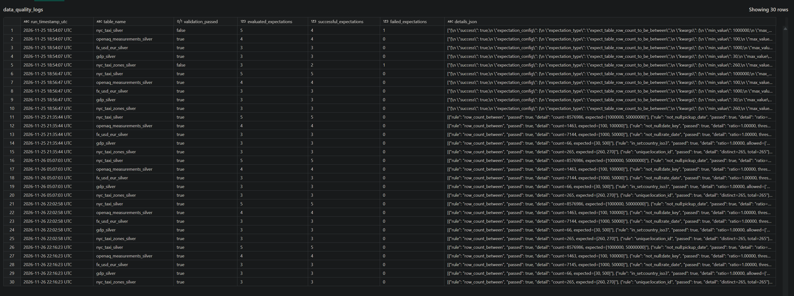

# Urban Analytics — Microsoft Fabric Data Engineering Platform

An end-to-end **Microsoft Fabric** data engineering project that turns **four public data domains
(plus the NYC TLC taxi zone lookup)** into a single, governed analytical model. Raw data lands in a
Bronze lakehouse, is cleansed and validated in a Silver lakehouse, and is modelled into a **star
schema** in `UrbanAnalyticsWarehouse`, which feeds a **Direct Lake** semantic model and a Power BI
report.

Ingestion, transformation, the data-quality gate, the warehouse load and a daily schedule are
orchestrated by one master pipeline, `pl_master_e2e`.

## Documentation map

| Document | What it covers |
|----------|----------------|
| **README.md** (this file) | Project overview, architecture, orchestration, sources, star schema, report, how to run |
| **[docs/data_dictionary.md](docs/data_dictionary.md)** | Column-by-column dictionary of all eight Gold tables with exact warehouse types and keys |
| **[docs/governance.md](docs/governance.md)** | Target governance policy: RBAC, PII/classification, audit-log retention, secrets |
| **[docs/architecture_decisions.md](docs/architecture_decisions.md)** | Why PySpark instead of Dataflow Gen2, data-scope limits, the DQ gate, and how to add a source |
| **[integrations/weather_timeseries/README.md](integrations/weather_timeseries/README.md)** | Additional integration: Open-Meteo weather enriched with taxi and PM2.5 data, loaded by a scheduled job into a KQL Eventhouse time-series database, with a Real-Time Dashboard |

---

## Architecture

The solution follows the **Medallion architecture** (Bronze → Silver → Gold) and separates compute
from storage: two lakehouses hold Delta tables, while a Fabric Warehouse holds the dimensional model
consumed by Power BI.

```
Public APIs / HTTP endpoints
        │
        ▼
┌──────────────────┐   ┌──────────────────┐   ┌────────────────────────┐
│ Lakehouse_Bronze │──▶│ Lakehouse_Silver │──▶│ UrbanAnalyticsWarehouse│
│  raw Delta/Files │   │ cleansed + DQ    │   │  star schema (T-SQL)   │
└──────────────────┘   └──────────────────┘   └───────────┬────────────┘
                                                         ▼
                                              UrbanAnalytics_SemanticModel (Direct Lake)
                                                         │
                                                         ▼
                                              UrbanAnalytics_Dashboard
```

The Fabric **lineage view** shows the real dependency graph: HTTP sources and notebooks feed
`pl_master_ingest_bronze`, which writes to `Lakehouse_Bronze`; the transformation notebooks and the
quality gate feed `pl_master_transform_silver`, which writes to `Lakehouse_Silver`;
`pl_master_load_gold` executes the T-SQL procedures, and the semantic model / report sit downstream.


*Figure 1 — End-to-end lineage. `nb_validate_data_quality` sits inside the Silver stage: no Gold table is loaded unless the quality gate passes.*

---

## Orchestration

`pl_master_e2e` is the single entry point. It runs three child pipelines strictly in sequence, each
gated on `Succeeded` of the previous activity:

| Stage | Pipeline | Activities |
|-------|----------|------------|
| 1. Bronze | `pl_master_ingest_bronze` | `Invoke_NYC_Taxi` → `Run_OpenAQ_Ingest` → `Run_GDP_Ingest` → `Run_FX_Ingest` → `Ingest_NYC_Zones` |
| 2. Silver | `pl_master_transform_silver` | `Transform_NYC_Taxi` → `Transform_OpenAQ` → `Transform_FX` → `Transform_GDP` (ends with the DQ gate) |
| 3. Gold | `pl_master_load_gold` | `Load_Gold_Dimensions` → `Load_Gold_Fact_Taxi` and `Load_Gold_Air_Quality` |

`pl_ingest_nyc_taxi` is a parameterised pipeline (`months_list`, default
`["2024-01","2024-02","2024-03"]`) that runs a **parallel ForEach** over the months and copies
`yellow_tripdata_<YYYY-MM>.parquet` from the NYC TLC CloudFront endpoint into
`Lakehouse_Bronze/Files/nyc_taxi`. A failure in the DQ gate stops the run before the warehouse is
touched, and Fabric keeps per-activity status, duration and input/output for every execution.


*Figure 2 — A successful end-to-end run. This run history is the project's operational observability view: status, start time, duration and input/output per activity.*

### Scheduled refresh (Phase 5)

`pl_master_e2e` carries an **active daily schedule**:

| Setting | Value |
|---------|-------|
| Frequency | Every day |
| Time of day | **06:00** |
| Time zone | **(UTC+01:00) Brussels, Copenhagen, Madrid, Paris** |
| Job type | Pipeline |
| Status | **Active** |
| Schedule ID | `60bd33aa-29e4-49f1-8575-641ed4ca51a7` |

Each morning the scheduler runs the full Bronze → Silver → Gold chain, so the warehouse and the
report are refreshed before the working day starts. Because the DQ gate is part of the Silver stage,
a bad nightly load fails the run and leaves the previous Gold snapshot intact. **Failure
notifications are configured: if a scheduled run fails, Fabric sends an e-mail to the project owner**
(the recipient is set in the *Failure notifications* field, visible in the screenshot below).


*Figure 3 — Phase 5: the daily 06:00 (UTC+01:00) schedule with e-mail failure notifications. The
scheduler is the normal operating mode; ad-hoc runs remain available for backfills and testing.*

---

## Data sources

| # | Source | API / endpoint | Granularity | Volume |
|---|--------|----------------|-------------|--------|
| 1 | **NYC TLC Yellow Taxi, Q1 2024** | `https://d37ci6vzurychx.cloudfront.net/trip-data/yellow_tripdata_2024-0{1,2,3}.parquet` | one row per trip | ≈ **9.55 M** raw rows → **8,576,986** cleaned trips in Gold |
| 2 | **OpenAQ v3 — NYC air quality** | `https://api.openaq.org/v3/locations` + `/v3/sensors/{id}/days` | daily averages per sensor (PM2.5, NO2) | 25 sensors max, 2024-01-01 → 2026-01-01 |
| 3 | **ECB — USD/EUR reference rate** | `https://data-api.ecb.europa.eu/service/data/EXR/D.USD.EUR.SP00.A?format=csvdata` | daily | ≈ 7.1 k daily observations (1999–2026) |
| 4 | **World Bank — US GDP** | `https://api.worldbank.org/v2/country/USA/indicator/NY.GDP.MKTP.CD` | yearly | 66 annual observations (1960–2025) |
| 5 | **NYC TLC taxi zone lookup** | `https://d37ci6vzurychx.cloudfront.net/misc/taxi_zone_lookup.csv` | one row per zone | 265 zones |

All sources are public and key-less, except OpenAQ v3, which requires an API key (see
[Security](#security-notes)).

---

## Medallion layers (summary)

| Layer | Item | What it holds |
|-------|------|---------------|
| **Bronze** | `Lakehouse_Bronze` | Raw Parquet files (`Files/nyc_taxi`) and raw Delta tables: `openaq_locations_bronze`, `openaq_measurements_bronze`, `gdp_bronze`, `fx_usd_eur_bronze`, `nyc_taxi_zones_bronze`. Re-runs overwrite with `overwriteSchema`. |
| **Silver** | `Lakehouse_Silver` | Typed, de-duplicated Delta tables: `nyc_taxi_silver`, `openaq_silver`, `openaq_measurements_silver`, `fx_usd_eur_silver`, `gdp_silver`, `nyc_taxi_zones_silver`, plus the audit table `data_quality_logs`. |
| **Gold** | `UrbanAnalyticsWarehouse` | Star schema built by T-SQL stored procedures reading Silver through three-part names (`[Lakehouse_Silver].[dbo].[...]`). |

---

## Data quality gate

`nb_validate_data_quality` runs as the last step of the Silver stage (it is `%run` from
`nb_transform_gdp`). Its `SilverQualitySuite` framework — modelled on Great Expectations — provides
`expect_row_count_between`, `expect_not_null`, `expect_between`, `expect_in_set` and
`expect_unique`, applied to all five Silver tables (taxi, OpenAQ measurements, FX, GDP, zones).

Every run appends **one row per table** to the audit Delta table **`data_quality_logs`**
(`run_timestamp_utc`, `table_name`, `validation_passed`, `evaluated/successful/failed_expectations`,
`details_json`), optionally posts a PASSED/FAILED message to a Discord/Teams webhook, and raises
`RuntimeError` when `fail_pipeline_on_error = True` — which fails the Silver activity and blocks
`pl_master_load_gold`.



*Figure 4 — The `data_quality_logs` audit table: historical runs side by side, including the earlier
failures on `nyc_taxi_silver` and `nyc_taxi_zones_silver` and the later runs where all five suites
passed.*

---

## Star schema in UrbanAnalyticsWarehouse

A classic **star schema** with five conformed dimensions and three fact tables:

| Dimensions | Facts |
|------------|-------|
| `dim_date` (one row per calendar date) | `fact_taxi_trips` (one row per trip, USD and EUR amounts) |
| `dim_zone` (one row per TLC zone) | `fact_taxi_daily` (one row per day) |
| `dim_fx_daily` (USD per EUR, gaps forward-filled) | `fact_air_quality_daily` (one row per day, PM2.5 + NO2) |
| `dim_gdp_yearly` (one row per year) | |
| `dim_air_quality_sensors` (one row per sensor) | |

The tables are created by `usp_load_gold_dimensions`, `usp_load_gold_fact_taxi` and
`usp_load_gold_air_quality`, which drop and recreate their targets (`CREATE TABLE … AS SELECT`), so a
Gold reload is idempotent. Column-level definitions, types and keys are in
**[docs/data_dictionary.md](docs/data_dictionary.md)**.


*Figure 5 — The warehouse object tree: five `dim_*` tables, three `fact_*` tables, the stored procedures, and the numbered DDL scripts kept as reusable queries.*

---

## Power BI reporting

`UrbanAnalytics_SemanticModel` is a **Direct Lake** model over the star schema — no import copy, the
report queries the Delta/warehouse data directly. `UrbanAnalytics_Dashboard` has **four analytical
pages** (also exported as `reports/UrbanAnalytics_Dashboard.pdf`):

1. **Mobility overview** — daily trips for Q1 2024, revenue by pickup hour, top pickup zones and KPIs (average fare 18.97 USD, 3.45 mi average distance, 9 M trips, 238.93 M USD revenue).
2. **Mobility vs. air quality** — trips overlaid with PM2.5, plus PM2.5 and NO2 trends for 2024–2026.
3. **Revenue in two currencies** — revenue in USD and EUR against the ECB USD/EUR rate.
4. **Macro context and sensor inventory** — US GDP 1960–2025 next to the sensor count by parameter.


*Figure 6 — Page 1: demand is bimodal (morning and evening peaks) and Manhattan's Upper East Side /
Midtown zones dominate pickups.*


*Figure 7 — Page 2: taxi demand and PM2.5 share the same weekly rhythm; NO2 stays in a narrow
0.01–0.04 ppm band.*


*Figure 8 — Page 3: the USD/EUR gap widens exactly where the ECB rate moves, confirming the FX join
and the forward-fill logic in `dim_fx_daily`.*


*Figure 9 — Page 4: annual GDP gives every trip a macro-economic context year, and the sensor
dimension documents which parameters the NYC stations report.*

---

## Repository structure

```
.
├── notebooks/      # 9 PySpark notebooks: ingest_* (Bronze) and transform_* (Silver) + DQ gate
├── pipelines/      # 5 pipeline definitions, incl. pl_master_e2e
├── sql/            # 01–05: dimensions, facts, stored procedures, Gold refresh
├── docs/
│   ├── data_dictionary.md
│   ├── governance.md
│   ├── architecture_decisions.md
│   └── screenshots/            # lineage, run history, schedule, DQ log, warehouse tree, report
├── integrations/
│   └── weather_timeseries/     # additional module: weather → Eventhouse (KQL) → Real-Time Dashboard
├── reports/UrbanAnalytics_Dashboard.pdf
├── .gitignore
└── README.md
```

---

## Running the project

1. **Workspace & items** — provision `Lakehouse_Bronze`, `Lakehouse_Silver`, `UrbanAnalyticsWarehouse`, `UrbanAnalytics_SemanticModel` (Direct Lake) and `UrbanAnalytics_Dashboard`.
2. **Notebooks** — import `notebooks/` and update the `workspace_id` / `bronze_lakehouse_id`
   variables at the top of each notebook (they are workspace-specific GUIDs).
3. **API key** — set `OPENAQ_API_KEY` in `nb_ingest_openaq` at runtime (never commit it).
4. **Pipelines** — import `pipelines/`, bind notebook activities, recreate the `HttpServer` /
   `Lakehouse_Bronze` connections.
5. **SQL — run `sql/01` to `sql/05` in order.** This is mandatory, not cosmetic:
   `05_update_gold_dims_and_facts.sql` **overwrites the `usp_load_gold_dimensions` definition** from
   `01` and `03` and **redefines `dim_date`** (it adds OpenAQ measurement dates and the `dim_zone` /
   `dim_fx_daily` dimensions). Running `05` before `01`–`03`, or stopping at `03`, leaves a stale
   procedure and an incomplete `dim_date`.
6. **Run** — start `pl_master_e2e`. On success you get refreshed Bronze/Silver tables, a reloaded
   star schema, new `data_quality_logs` rows and a refreshed report.
7. **Schedule** — add the daily **06:00 (UTC+01:00)** schedule and a failure-notification address (see [Scheduled refresh](#scheduled-refresh-phase-5)).

---

## Security notes

* **`OPENAQ_API_KEY` is a placeholder** (`"YOUR_API_KEY"`). No real credential is stored in this
  repository; supply it through a Fabric variable library, a Key Vault-backed connection or an
  environment variable, and never commit it.
* **No other secrets are committed** — NYC TLC, ECB and World Bank are public and key-less.
* `.gitignore` excludes `.ipynb_checkpoints/`, `.jupyter/`, `__pycache__/` and `.env`.
* Notebooks contain only workspace/artifact GUIDs, which are not credentials.
* Access, classification and retention rules are described in **[docs/governance.md](docs/governance.md)**.
