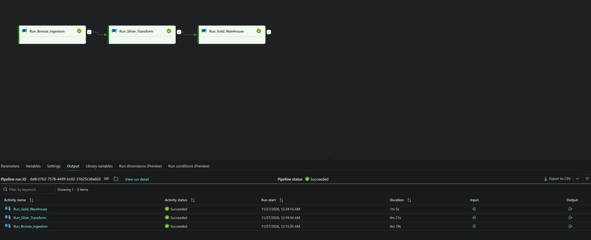
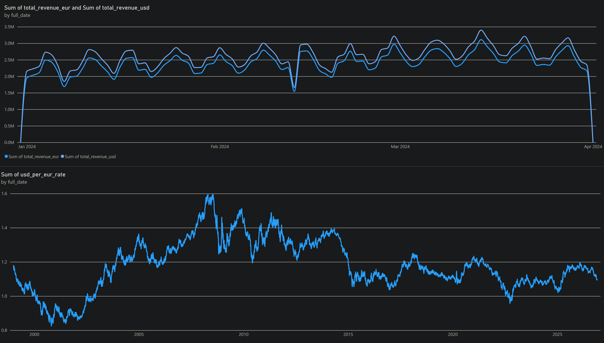
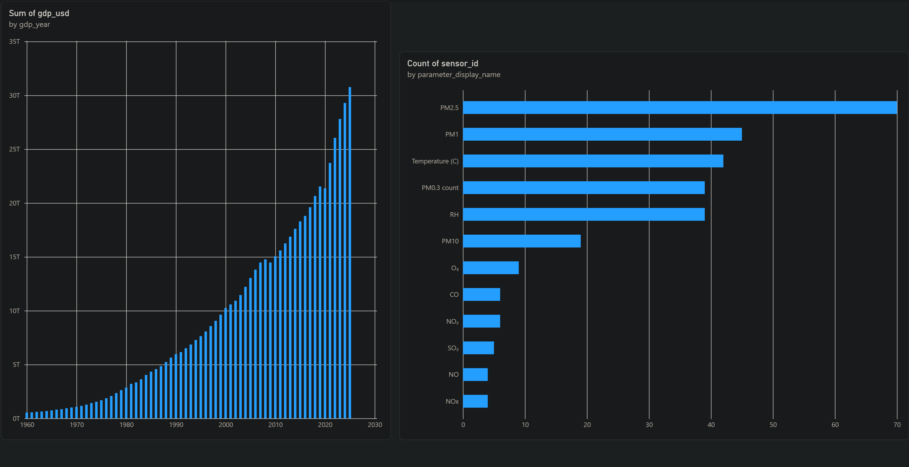

# Urban Analytics — Microsoft Fabric Data Engineering Platform

An end-to-end **Microsoft Fabric** data engineering project that turns four unrelated public
datasets into a single, governed analytical model. Raw data is ingested into a Bronze lakehouse,
cleansed and validated in a Silver lakehouse, and modelled into a **star schema** inside a Fabric
Warehouse (`UrbanAnalyticsWarehouse`) that feeds a Power BI semantic model and report.

The whole flow — ingestion, transformation, the data-quality gate and the warehouse load — is
orchestrated by a single master pipeline, `pl_master_e2e`.

---

## Table of contents

1. [Architecture](#architecture)
2. [Orchestration](#orchestration)
3. [Data sources](#data-sources)
4. [Medallion layers](#medallion-layers)
5. [Data quality gate](#data-quality-gate)
6. [Star schema in UrbanAnalyticsWarehouse](#star-schema-in-urbananalyticswarehouse)
7. [Power BI reporting](#power-bi-reporting)
8. [Repository structure](#repository-structure)
9. [Running the project](#running-the-project)
10. [Security notes](#security-notes)

---

## Architecture

The solution follows the **Medallion architecture** (Bronze → Silver → Gold) and separates
compute from storage: two lakehouses hold Delta tables, while a dedicated Fabric Warehouse holds
the dimensional model consumed by Power BI.

```
Public APIs / HTTP endpoints
        │
        ▼
┌──────────────────┐   ┌──────────────────┐   ┌────────────────────────┐
│ Lakehouse_Bronze │──▶│ Lakehouse_Silver │──▶│ UrbanAnalyticsWarehouse│
│  raw Delta/Files │   │ cleansed + DQ    │   │  star schema (T-SQL)   │
└──────────────────┘   └──────────────────┘   └───────────┬────────────┘
                                                         ▼
                                              UrbanAnalytics_SemanticModel
                                                         │
                                                         ▼
                                              UrbanAnalytics_Dashboard
```

The Fabric **lineage view** below shows the real dependency graph: HTTP sources and notebooks feed
`pl_master_ingest_bronze`, which writes to `Lakehouse_Bronze`; the transformation notebooks feed
`pl_master_transform_silver`, which writes to `Lakehouse_Silver`; `pl_master_load_gold` executes the
T-SQL procedures against the warehouse, and the semantic model / report sit downstream.


*Figure 1 — End-to-end lineage in Microsoft Fabric. Note the central position of
`nb_validate_data_quality` inside the Silver stage: no Gold table is loaded unless the quality gate
passes.*

---

## Orchestration

`pl_master_e2e` is the single entry point. It runs three child pipelines strictly in sequence, each
one gated on `Succeeded` of the previous activity:

| Stage | Pipeline | Activities |
|-------|----------|------------|
| 1. Bronze | `pl_master_ingest_bronze` | `Invoke_NYC_Taxi` → `Run_OpenAQ_Ingest` → `Run_GDP_Ingest` → `Run_FX_Ingest` → `Ingest_NYC_Zones` |
| 2. Silver | `pl_master_transform_silver` | `Transform_NYC_Taxi` → `Transform_OpenAQ` → `Transform_FX` → `Transform_GDP` |
| 3. Gold | `pl_master_load_gold` | `Load_Gold_Dimensions` → `Load_Gold_Fact_Taxi` and `Load_Gold_Air_Quality` (both after the dimensions) |

`pl_ingest_nyc_taxi` is a parameterised pipeline (`months_list`, default `["2024-01","2024-02","2024-03"]`)
that runs a **parallel ForEach** over the months and copies
`yellow_tripdata_<YYYY-MM>.parquet` from the NYC TLC CloudFront endpoint into
`Lakehouse_Bronze/Files/nyc_taxi`.

Because every stage is a separate child pipeline, a failure in the data-quality gate stops the run
before the warehouse is touched, and Fabric keeps per-activity status, duration and input/output for
each execution.



*Figure 2 — A successful end-to-end run of `pl_master_e2e`. All three stages completed and the Gold
warehouse was refreshed only after the Silver stage (including the DQ gate) finished successfully.*

---

## Data sources

| # | Source | API / endpoint | Granularity | Volume |
|---|--------|----------------|-------------|--------|
| 1 | **NYC TLC Yellow Taxi, Q1 2024** | `https://d37ci6vzurychx.cloudfront.net/trip-data/yellow_tripdata_2024-0{1,2,3}.parquet` | one row per trip | ≈ **9.55 M** raw rows → **8,576,986** cleaned trips in Gold |
| 2 | **OpenAQ v3 — NYC air quality** | `https://api.openaq.org/v3/locations` + `/v3/sensors/{id}/days` | daily averages per sensor (PM2.5, NO2) | 25 sensors max, 2024-01-01 → 2026-01-01 |
| 3 | **ECB — USD/EUR reference rate** | `https://data-api.ecb.europa.eu/service/data/EXR/D.USD.EUR.SP00.A?format=csvdata` | daily | ≈ 7.1 k daily observations |
| 4 | **World Bank — US GDP** | `https://api.worldbank.org/v2/country/USA/indicator/NY.GDP.MKTP.CD` | yearly | 66 annual observations |
| 5 | **NYC TLC taxi zone lookup** | `https://d37ci6vzurychx.cloudfront.net/misc/taxi_zone_lookup.csv` | one row per zone | 265 zones |

All sources are **public and key-less**, except OpenAQ v3, which requires an API key
(see [Security notes](#security-notes)).

---

## Medallion layers

### Bronze — `Lakehouse_Bronze`

Raw, append-only landing zone. Data is stored as-is, in Delta where a schema is useful and as
Parquet files where the source is a file drop:

| Object | Format | Written by |
|--------|--------|-----------|
| `Files/nyc_taxi/yellow_tripdata_2024-0*.parquet` | Parquet (binary copy) | `pl_ingest_nyc_taxi` |
| `Tables/dbo/openaq_locations_bronze` | Delta | `nb_ingest_openaq` |
| `Tables/dbo/openaq_measurements_bronze` | Delta | `nb_ingest_openaq` |
| `Tables/dbo/gdp_bronze` | Delta | `nb_ingest_gdp` |
| `Tables/dbo/fx_usd_eur_bronze` | Delta | `nb_ingest_fx` |
| `Tables/dbo/nyc_taxi_zones_bronze` | Delta | `nb_ingest_zones` |

Notebooks use `requests` + `pandas`/`json` for extraction and write with
`mode("overwrite").option("overwriteSchema", "true")`, so a re-run always produces a clean,
reproducible snapshot. The OpenAQ notebook handles HTTP 429 with a retry/back-off and caps the
number of queried sensors (`MAX_SENSORS_TO_FETCH = 25`) to stay inside API rate limits.

### Silver — `Lakehouse_Silver`

Conformed, typed and de-duplicated Delta tables — the single source of truth for the warehouse:

| Table | Key transformations |
|-------|---------------------|
| `nyc_taxi_silver` | lowercase schema, timestamp casting, `trip_duration_minutes`, filters (duration 0–1440 min, `fare_amount > 0`, `total_amount > 0`, `passenger_count > 0`, pickup year 2020–2026), derived `pickup_date` / `pickup_year` / `pickup_month` / `pickup_hour`, `dropDuplicates()`. Zero-distance trips are **kept on purpose** (waiting time / cancellation charges). |
| `openaq_silver` | `explode_outer(sensors)` to flatten station + sensor metadata into one dimension-ready table; casts, coordinate and parameter renaming, `dropDuplicates(["location_id","sensor_id"])`. |
| `openaq_measurements_silver` | date parsing + `date_key` (`yyyyMMdd`), lowercase parameter names, outlier filter (`0 ≤ avg_value < 1000`), de-duplication per sensor/day, then aggregation to one row per day × parameter with `daily_avg/min/max_value` and `active_sensors_count`. |
| `fx_usd_eur_silver` | date parsing from `TIME_PERIOD`, `exchange_rate` cast, positive-rate filter, de-duplication on `(rate_date, currency, currency_denom)`. |
| `gdp_silver` | flattening of the World Bank JSON envelope into `country_iso3`, `year`, `gdp_usd`, de-duplicated per country/year. |
| `nyc_taxi_zones_silver` | trimmed `borough` / `zone_name` / `service_zone`, integer `location_id`, de-duplicated. |

### Gold — `UrbanAnalyticsWarehouse`

A Fabric **Warehouse** (T-SQL, not Spark) that reads the Silver Delta tables through cross-database
three-part names (`[Lakehouse_Silver].[dbo].[...]`) and materialises the star schema. Everything is
created or refreshed by stored procedures, so a Gold reload is a single `EXEC`.

---

## Data quality gate

`nb_validate_data_quality` runs as the last step of the Silver stage (it is also `%run` from
`nb_transform_gdp`). It implements a small, dependency-free expectations framework —
`SilverQualitySuite` — with five reusable checks:

| Check | Purpose |
|-------|---------|
| `expect_row_count_between(min, max)` | catches empty loads and duplicated appends |
| `expect_not_null(col, mostly)` | completeness of key columns |
| `expect_between(col, min, max, mostly)` | range/outlier control (distances, amounts, hours, rates) |
| `expect_in_set(col, allowed)` | domain checks (e.g. `parameter_name ∈ {pm25, no2}`, `country_iso3 = USA`) |
| `expect_unique(col)` | primary-key sanity (e.g. `dim_zone.location_id`) |

Rules are applied to all five Silver tables, for example:

* `nyc_taxi_silver`: 1 M – 50 M rows, `pickup_date` not null, `trip_distance` 0–500 mi,
  `total_amount` 0.01–5 000 USD, `pickup_hour` 0–23.
* `openaq_measurements_silver`: 100 – 100 000 rows, `parameter_name ∈ {pm25, no2}`,
  `daily_avg_value` 0–1 000.
* `fx_usd_eur_silver`: `exchange_rate` between 0.5 and 2.5.
* `gdp_silver`: `country_iso3 = USA`, `gdp_usd` between 1e11 and 1e14.
* `nyc_taxi_zones_silver`: 260–270 rows, unique `location_id`.

Every run appends one row per table to the audit Delta table **`data_quality_logs`**
(`run_timestamp_utc`, `table_name`, `validation_passed`, `evaluated/successful/failed_expectations`,
`details_json`). The notebook then:

1. optionally posts a PASSED/FAILED notification to a Discord/Teams webhook (`webhook_url`),
2. raises `RuntimeError` when `fail_pipeline_on_error = True` and any expectation failed — which
   fails the Silver activity and therefore prevents `pl_master_load_gold` from running.


*Figure 3 — The `data_quality_logs` audit table. Historical runs are visible side by side, including
the earlier runs where `nyc_taxi_silver` and `nyc_taxi_zones_silver` failed, and the later green runs
where all five suites passed. The `details_json` column keeps the full expectation output for
traceability.*

---

## Star schema in UrbanAnalyticsWarehouse

The Gold model is a classic **star schema**: conformed dimensions shared by two fact tables
(taxi mobility and daily air quality), enriched with macro-economic context.

**Dimensions**

| Table | Grain | Source |
|-------|-------|--------|
| `dim_date` | one row per calendar date | union of taxi pickup dates, FX rate dates and air-quality measurement dates |
| `dim_zone` | one row per NYC TLC taxi zone | `nyc_taxi_zones_silver` |
| `dim_fx_daily` | one row per date, USD per EUR | `fx_usd_eur_silver`, weekend/holiday gaps forward-filled with a `LAST_VALUE`-style window (`COUNT` grouping + `MAX`) |
| `dim_gdp_yearly` | one row per year | `gdp_silver` |
| `dim_air_quality_sensors` | one row per sensor | `openaq_silver` |

**Facts**

| Table | Grain | Highlights |
|-------|-------|-----------|
| `fact_taxi_trips` | one row per trip | surrogate `date_key`, `gdp_year`, pickup/dropoff, vendor, PU/DO zone, payment type, distance, duration, fare/tip/total in USD **and** `total_amount_eur` converted at the daily ECB rate |
| `fact_taxi_daily` | one row per day | `total_trips`, `total_passengers`, distance and duration averages, revenue USD/EUR, FX rate |
| `fact_air_quality_daily` | one row per day | pivoted PM2.5 and NO2 average/min/max plus active sensor counts |

**Stored procedures** (T-SQL, in `sql/`)

| Procedure | Refreshes |
|-----------|-----------|
| `usp_load_gold_dimensions` | `dim_date`, `dim_zone`, `dim_fx_daily`, `dim_gdp_yearly`, `dim_air_quality_sensors` |
| `usp_load_gold_fact_taxi` | `fact_taxi_trips`, `fact_taxi_daily` |
| `usp_load_gold_air_quality` | `fact_air_quality_daily` |

Each procedure drops and recreates its target tables (`CREATE TABLE … AS SELECT`), which makes the
Gold layer fully idempotent and safe to re-run.


*Figure 4 — The warehouse object tree: five `dim_*` tables, three `fact_*` tables, the stored
procedures, and the numbered DDL scripts kept as reusable queries in the Fabric SQL editor.*

---

## Power BI reporting

`UrbanAnalytics_SemanticModel` is a Direct Lake / import model over the star schema; the report
`UrbanAnalytics_Dashboard` has five pages, exported here as screenshots
(`reports/UrbanAnalytics_Dashboard.pdf` contains the same report as a PDF).

### Page 1 — Mobility overview

Daily trip volume for Q1 2024, revenue distribution by hour of day, the top pickup zones and the
headline KPIs: average fare **18.97 USD**, average trip distance **3.45 mi**, **9 M** trips and
**238.93 M USD** of revenue.


*Figure 5 — Demand is strongly bimodal (morning and evening commute peaks), and Manhattan's Upper
East Side / Midtown zones dominate pickup volume.*

### Page 2 — Mobility vs. air quality

A combo chart overlays daily trips (bars) with daily PM2.5 (line), and two trend charts show PM2.5
and NO2 across the full 2024 → 2026 measurement window, which makes it possible to compare weekday
traffic cycles with pollution episodes.


*Figure 6 — Taxi demand and PM2.5 move on the same weekly rhythm, while NO2 stays in a narrow
0.01–0.04 ppm band with occasional spikes.*

### Page 3 — Revenue in two currencies

Total revenue in USD and EUR follows the ECB USD/EUR reference rate, so the currency effect is
visible directly on the revenue line; the second chart plots the daily exchange rate itself.



*Figure 7 — The USD/EUR gap on the revenue lines widens exactly where the ECB rate moves, proving
the FX join and the forward-fill logic in `dim_fx_daily`.*

### Page 4 — Macro context and sensor inventory

US GDP by year (1960 → 2024, in USD trillions) alongside the sensor inventory of the air-quality
dimension, broken down by measured parameter.



*Figure 8 — `dim_gdp_yearly` gives every taxi trip a macro-economic context year, and
`dim_air_quality_sensors` documents exactly which parameters the NYC stations report.*

### Page 5 — Pipeline observability

The last page is not a data visual but operational evidence: the successful `pl_master_e2e` run with
per-activity status and duration (see [Figure 2](#orchestration)).

---

## Repository structure

```
.
├── notebooks/
│   ├── nb_ingest_fx.ipynb              # ECB USD/EUR → Bronze
│   ├── nb_ingest_gdp.ipynb             # World Bank US GDP → Bronze
│   ├── nb_ingest_openaq.ipynb          # OpenAQ v3 stations + PM2.5/NO2 → Bronze
│   ├── nb_ingest_zones.ipynb           # TLC zone lookup → Bronze + Silver
│   ├── nb_transform_fx.ipynb           # Bronze → fx_usd_eur_silver
│   ├── nb_transform_gdp.ipynb          # Bronze → gdp_silver, then runs the DQ gate
│   ├── nb_transform_openaq.ipynb       # Bronze → openaq_silver, openaq_measurements_silver
│   ├── nb_transform_taxi.ipynb         # Parquet → nyc_taxi_silver
│   └── nb_validate_data_quality.ipynb  # SilverQualitySuite → data_quality_logs
├── pipelines/
│   ├── pl_ingest_nyc_taxi.json         # parameterised monthly Parquet copy
│   ├── pl_master_ingest_bronze.json    # Bronze stage
│   ├── pl_master_transform_silver.json # Silver stage (+ DQ gate)
│   ├── pl_master_load_gold.json        # Gold warehouse stage
│   └── pl_master_e2e.json              # master orchestration
├── sql/
│   ├── 01_create_gold_dimensions.sql
│   ├── 02_create_gold_fact_taxi.sql
│   ├── 03_create_gold_stored_procedures.sql
│   ├── 04_usp_load_gold_air_quality.sql
│   └── 05_update_gold_dims_and_facts.sql
├── docs/screenshots/                   # lineage, DQ audit log, warehouse tree, report pages
├── reports/UrbanAnalytics_Dashboard.pdf
├── .gitignore
└── README.md
```

---

## Running the project

1. **Workspace & items** — create a Fabric workspace and provision:
   `Lakehouse_Bronze`, `Lakehouse_Silver`, `UrbanAnalyticsWarehouse`,
   `UrbanAnalytics_SemanticModel` and `UrbanAnalytics_Dashboard`.
2. **Notebooks** — import the files from `notebooks/` into the workspace and update the
   `workspace_id` / `bronze_lakehouse_id` variables at the top of each notebook to match your
   workspace and Bronze lakehouse (they are workspace-specific GUIDs).
3. **API key** — set `OPENAQ_API_KEY` in `nb_ingest_openaq` (see below).
4. **Pipelines** — import the JSON definitions from `pipelines/`, bind the notebook activities to
   the imported notebooks, and re-create the `HttpServer` / `Lakehouse_Bronze` connections.
5. **SQL** — run `sql/01…05` once in the warehouse SQL editor to create the dimensions, the facts
   and the stored procedures.
6. **Run** — start `pl_master_e2e`. On success you get refreshed Bronze/Silver Delta tables, a
   reloaded star schema, a new `data_quality_logs` audit row per table, and a refreshed report.

---

## Security notes

* **`OPENAQ_API_KEY` is a placeholder.** The notebook ships with
  `OPENAQ_API_KEY = "YOUR_API_KEY"`; no real credential is stored in this repository. Supply the key
  at runtime — for example through a Fabric variable library, a Key Vault-backed connection, or an
  environment variable read inside the notebook — and never commit it.
* **No other secrets are committed.** All remaining sources (NYC TLC, ECB, World Bank) are public.
* `.gitignore` excludes notebook checkpoints (`.ipynb_checkpoints/`, `.jupyter/`), Python caches
  (`__pycache__/`) and local environment files (`.env`).
* The notebooks intentionally contain only workspace/artifact GUIDs, which are not credentials.
