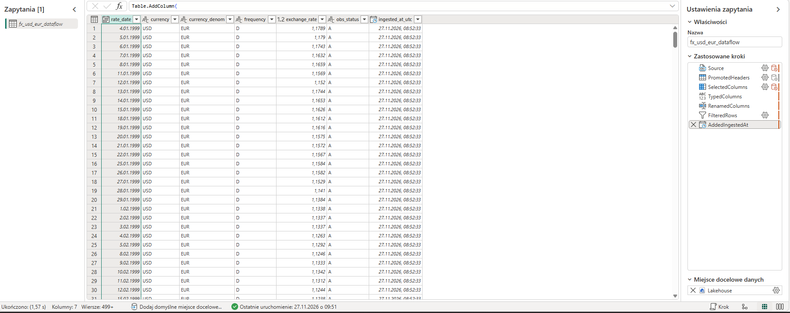
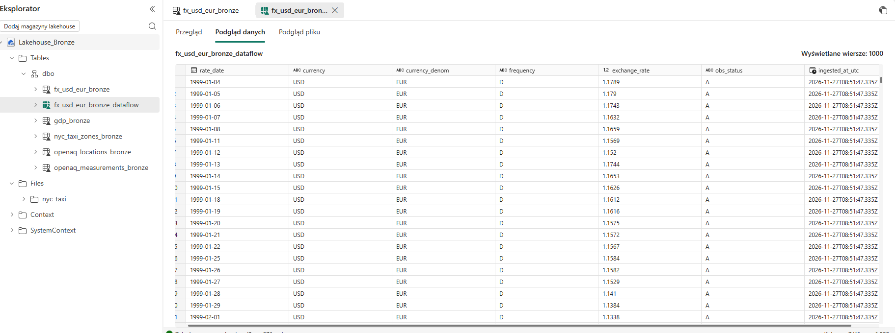

# Architecture Decisions & Trade-offs

The three decisions below explain why the platform is built the way it is. Each one lists the
alternatives considered, the reason for the choice and the cost that was accepted. The last section
is a practical guide for extending the platform.

Back to the [project overview](../README.md) · [data dictionary](data_dictionary.md) ·
[governance](governance.md)

---

## a) PySpark notebooks instead of Dataflow Gen2 for Bronze ingestion

**Decision:** the OpenAQ, World Bank and ECB sources are ingested into **Bronze** by PySpark
notebooks (`nb_ingest_openaq`, `nb_ingest_gdp`, `nb_ingest_fx`), not by Dataflow Gen2.

Dataflow Gen2 is a good fit for GUI-driven, low-code transformations, but it is a poor fit for these
three APIs:

* **HTTP 429 must be handled imperatively.** OpenAQ v3 rate-limits clients. The notebook catches
  `429`, sleeps, retries the request and paces the sensor loop (`time.sleep(0.25)`). That control
  flow is natural in Python and awkward to express reliably in a Dataflow query.
* **The sensor cap must be explicit.** `MAX_SENSORS_TO_FETCH = 25` keeps the run inside the API
  budget and the Trial capacity; the cap is a named constant in code, visible in review.
* **Nested JSON must be flattened.** OpenAQ station payloads nest `sensors[]`, `coordinates`,
  `country`, `provider` and `owner`. `explode_outer` plus dotted column access is expressive and
  testable; the World Bank payload additionally needs its JSON envelope unwrapped before it can be
  turned into rows.
* **One language end-to-end.** Ingestion, transformation, the DQ framework and the audit log are all
  Python/PySpark, so shared helpers (e.g. `SilverQualitySuite`) are plain importable code and
  everything is diffable in Git.

**Trade-off accepted:** more code to maintain than a visual dataflow, and roughly 1–2 minutes of
Spark session start-up per notebook. In exchange, API quirks are handled deterministically and the
whole pipeline is reviewable like application code.

### Dataflow Gen2 reference implementation (ECB FX)

To show that the Dataflow Gen2 route works as well, the ECB source is **also** ingested by a
Dataflow Gen2, `df_ingest_fx_ecb`, as a standalone reference implementation.

| Item | Value |
|------|-------|
| Dataflow | `df_ingest_fx_ecb` (query `fx_usd_eur_dataflow`) |
| Source | ECB CSV (`EXR/D.USD.EUR.SP00.A`), anonymous Web connector |
| Steps | promote headers → keep 6 columns → set types with the **`en-US`** culture → rename to snake_case → drop empty/non-positive rates → add `ingested_at_utc` |
| Destination | `Lakehouse_Bronze` / `dbo` / **`fx_usd_eur_bronze_dataflow`**, update method **Replace** |
| Output | 7 columns: `rate_date`, `currency`, `currency_denom`, `frequency`, `exchange_rate`, `obs_status`, `ingested_at_utc` |
| Source code | [`dataflows/df_ingest_fx_ecb.pq`](../dataflows/df_ingest_fx_ecb.pq) (Power Query M) |

* **Culture matters.** With a Polish locale the default type detection read rates such as `1.1789`
  as dates (`1.01.1789`). Typing the columns explicitly with the `en-US` culture fixes this; the
  same issue does not exist in PySpark, where `cast("double")` is locale-independent.
* **Isolation by design.** The dataflow writes to its **own** table and is **not** part of
  `pl_master_e2e`, so the production `fx_usd_eur_bronze` table (written by `nb_ingest_fx`) and the
  nightly load are untouched. Both tables can be compared side by side in Bronze.
* **Conclusion.** For a flat CSV such as ECB, Dataflow Gen2 is a good, low-code fit. For OpenAQ
  (rate limits, nested JSON) the notebook approach above remains the better choice.

---

## b) NYC Taxi scoped to Q1 2024, with a fully parameterised pipeline

**Decision:** `pl_ingest_nyc_taxi` accepts a `months_list` parameter (default
`["2024-01","2024-02","2024-03"]`). The committed default covers **Q1 2024 only**, which yields
**8 576 986** cleaned trips in `fact_taxi_trips`.

The ingestion is *not* hard-coded to three months — any range can be backfilled by changing one
parameter. The default is limited on purpose:

* Loading years of TLC Parquet files would exceed **Fabric Trial capacity**; the platform answers
  with **HTTP 430 / capacity throttling**, turning a demo into a failed run.
* Three months already exercise every pattern the project needs: daily seasonality, hourly peaks,
  zone concentration, currency conversion and the air-quality join.
* **The long time horizon comes from the dimensions, not the fact table:** US GDP (1960–2025), ECB
  USD/EUR rates (1999–2026) and OpenAQ measurements (2024–2026) give the report a multi-decade
  context while the trip fact stays small enough to refresh nightly.

**Trade-off accepted:** the trip fact covers a quarter, not a decade, so year-over-year taxi
comparisons are out of scope. Scaling up is a parameter change plus a capacity decision — not a
redesign.

---

## c) Quality gate as `%run nb_validate_data_quality` at the end of `nb_transform_gdp`

**Decision:** the data-quality gate is executed from inside the last transformation notebook
(`nb_transform_gdp` ends with `%run nb_validate_data_quality`) rather than as a separate pipeline
activity.

* The framework is **modelled on Great Expectations** — expectations, per-rule pass/fail, structured
  result payload — but implemented in ~120 lines of PySpark, so there is no external dependency to
  install or version in Fabric.
* Running it via `%run` reuses the **same Spark session**, immediately after the last Silver table is
  written, with zero extra cluster start-up cost.
* `fail_pipeline_on_error = True` makes the notebook raise `RuntimeError` when any suite fails. That
  fails `Transform_GDP`, which fails `pl_master_transform_silver`, and — because
  `pl_master_load_gold` depends on `Succeeded` — **blocks the Gold load entirely**. The previous Gold
  snapshot stays published, so the report never shows partially validated data.
* The same run writes audit rows to `data_quality_logs` and, when `webhook_url` is configured, posts
  a PASSED/FAILED message to Discord/Teams, so failures are visible without opening Fabric.

**Trade-off accepted:** the gate is coupled to the Silver stage, so a failure surfaces on
`nb_transform_gdp` rather than on a dedicated activity. This is mitigated by `data_quality_logs`,
which records exactly which table and which rule failed.

---

## Extensibility — How to Add a New Data Source

The pipeline is uniform: **one ingest notebook per source, one transform notebook per source, one
block of expectations, one procedure per fact/dimension group**. Adding a source follows five steps.

1. **Ingest into Bronze.** Create `notebooks/nb_ingest_<source>.ipynb`. Read `workspace_id` /
   `bronze_lakehouse_id`, fetch the data with `requests` (apply the same `429` retry/back-off and a
   hard cap on requests as the OpenAQ notebook), convert to Spark and write
   `Tables/dbo/<source>_bronze` with `mode("overwrite").option("overwriteSchema", "true")`.
2. **Wire it into orchestration.** Add a notebook activity (e.g. `Run_<Source>_Ingest`) to
   `pipelines/pl_master_ingest_bronze.json` with `dependsOn` → `Succeeded` of the previous activity,
   so the Bronze stage stays strictly sequential and the new source cannot be skipped silently.
3. **Transform to Silver and register quality rules.** Create
   `notebooks/nb_transform_<source>.ipynb` that reads the Bronze table, applies typing, filtering and
   `dropDuplicates()`, and writes `<source>_silver`. Then add a
   `SilverQualitySuite("<source>_silver")` block in `nb_validate_data_quality` with at least
   `expect_row_count_between`, `expect_not_null` on the business key and `expect_between` /
   `expect_in_set` on the main measures, and include it in the `all_passed = all([...])` expression.
4. **Extend the Gold model.** Add the T-SQL in `sql/` (new `dim_*` / `fact_*` table plus
   `CREATE OR ALTER PROCEDURE dbo.usp_load_gold_<source>`), register the procedure as a
   `SqlServerStoredProcedure` activity in `pipelines/pl_master_load_gold.json`, and document every
   column in the [data dictionary](data_dictionary.md).
5. **Refresh the semantic model.** Add the table to `UrbanAnalytics_SemanticModel`, define the
   relationships to `dim_date` (and other conformed dimensions), add measures, refresh, and extend
   the report. Finally update this documentation set and run `pl_master_e2e` end-to-end to confirm
   the new source passes the gate.
