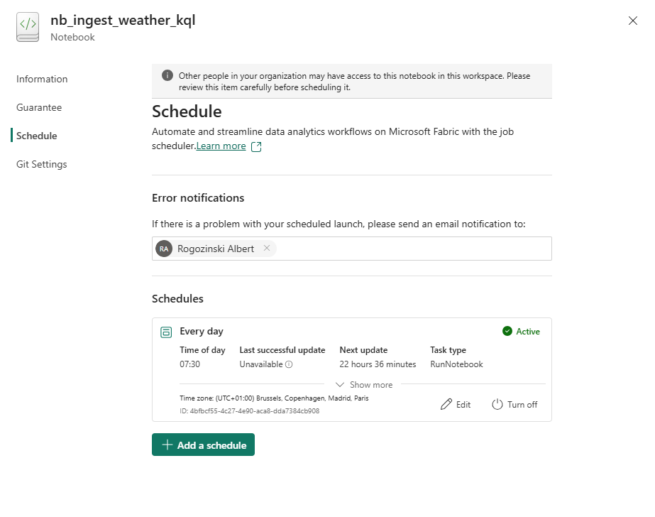
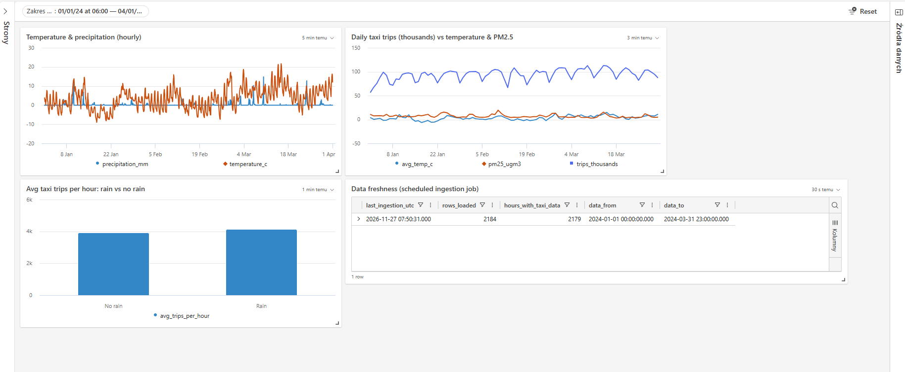

# Weather Time-Series Module (additional integration)

An add-on to the Urban Analytics platform that implements the first optional integration:
**weather data → periodic job → separate time-series database → analytical dashboard.**

The module is **fully isolated from the core pipeline**: it does not modify `pl_master_e2e`, its
child pipelines, the Silver tables or the warehouse. It only *reads* Silver tables and writes to its
own database, so it cannot break the nightly core load.

Back to the [project overview](../../README.md)

---

## Architecture

```
Open-Meteo Archive API (hourly, UTC)
        │
        ▼
nb_ingest_weather_kql  (PySpark notebook, own daily schedule)
   ├─ convert UTC → America/New_York (DST-safe)
   ├─ derive is_rainy_hour, temp_band
   ├─ enrich with hourly taxi aggregates   ← Lakehouse_Silver.nyc_taxi_silver
   └─ enrich with daily PM2.5              ← Lakehouse_Silver.openaq_measurements_silver
        │  KQL REST API (.ingest inline), Fabric session token
        ▼
NYC_Weather_Eventhouse  (KQL database = time-series store)
   └─ table nyc_weather_hourly
        │
        ▼
NYC_Weather_Dashboard  (Fabric Real-Time Dashboard, 4 tiles)
```

| Component | Fabric item | Role |
|-----------|-------------|------|
| Ingestion job | `nb_ingest_weather_kql` | Fetches, enriches and loads the data |
| Time-series DB | `NYC_Weather_Eventhouse` (KQL database) | Separate store optimised for time-series queries |
| Dashboard | `NYC_Weather_Dashboard` (Real-Time Dashboard) | Analysis of weather vs mobility and air quality |

---

## Data source

* **Open-Meteo Historical Weather API** (`archive-api.open-meteo.com/v1/archive`), public and key-less.
* Location: New York City (40.7128, -74.0060).
* Variables: `temperature_2m`, `precipitation`, `rain`, `snowfall`, `wind_speed_10m` (hourly).
* Window: **2024-01-01 → 2024-03-31**, aligned with the NYC Taxi scope of the core project
  (Q1 2024) so every weather hour can be joined with taxi demand. **2 184 hourly rows.**
* Requested in UTC; local time is derived in Spark with `from_utc_timestamp(..., "America/New_York")`,
  which handles the DST switch on 2024-03-10 correctly.

---

## Enrichment

Each weather hour is enriched in PySpark before it is written:

| Added column(s) | Source | Logic |
|-----------------|--------|-------|
| `timestamp_local` | weather | UTC → America/New_York |
| `is_rainy_hour` | weather | `precipitation_mm >= 0.5` |
| `temp_band` | weather | freezing (<0 °C) / cold (<10) / mild (<20) / warm |
| `taxi_trips`, `taxi_avg_fare_usd`, `taxi_revenue_usd`, `taxi_avg_duration_min` | `nyc_taxi_silver` | hourly aggregates joined on local date + local hour |
| `pm25_daily_avg_ugm3` | `openaq_measurements_silver` | city-wide daily PM2.5 joined on local date |

Result: **2 184 rows, 2 179 of them with taxi data.** The 5 unmatched hours are
2024-01-01 00:00–04:00 UTC, which is still 2023-12-31 19:00–23:00 in New York, i.e. before the
start of the taxi data (Q1 2024 in local time).

---

## Target table `nyc_weather_hourly`

| Column | KQL type | Meaning |
|--------|----------|---------|
| `timestamp_utc` | datetime | Hour in UTC (time axis of the dashboard) |
| `timestamp_local` | datetime | Same hour in New York local time |
| `city` | string | `New York` |
| `latitude`, `longitude` | real | Location of the weather point |
| `temperature_c` | real | Air temperature at 2 m, °C |
| `precipitation_mm` | real | Total precipitation, mm |
| `rain_mm` | real | Rain, mm |
| `snowfall_cm` | real | Snowfall, cm |
| `wind_speed_kmh` | real | Wind speed at 10 m, km/h |
| `is_rainy_hour` | int | 1 if precipitation ≥ 0.5 mm |
| `temp_band` | string | Temperature category |
| `taxi_trips` | long | Taxi trips started in that hour |
| `taxi_avg_fare_usd` | real | Average fare in that hour |
| `taxi_revenue_usd` | real | Total charged amount in that hour |
| `taxi_avg_duration_min` | real | Average trip duration |
| `pm25_daily_avg_ugm3` | real | Daily city-wide PM2.5, µg/m³ |
| `ingested_at_utc` | datetime | When the job wrote the row (freshness indicator) |

---

## Loading into the time-series database

* The built-in Spark → Kusto connector (`KustoSinkProvider`) failed in this Fabric Trial environment
  (it requires an external Blob staging container), so the notebook writes through the **KQL REST
  management API** with `.ingest inline`, authenticated with the token of the current Fabric
  session (`notebookutils.credentials.getToken`). No secret is stored in the notebook.
* Every run **drops and recreates** the table and reloads it in batches of 500 rows. This makes the job
  idempotent and guarantees that the CSV column order always matches the table schema.
* The notebook ends with a verification query (`| count`) and fails if the row count in the
  Eventhouse differs from the number of rows sent.
* Open-Meteo requests use a 90 s timeout and retry with back-off.

**Trade-off accepted:** `.ingest inline` is meant for small volumes. It is a good fit for ~2 k rows;
for large or streaming volumes the next step would be queued ingestion or an Eventstream.

---

## Periodic execution

The notebook has its **own daily schedule in Fabric**, separate from the 06:00 schedule of
`pl_master_e2e`, so the two jobs never compete for Spark capacity. It runs daily at
**07:30 (UTC+01:00)**.



---

## Dashboard

`NYC_Weather_Dashboard` is a Fabric **Real-Time Dashboard** on top of `NYC_Weather_Eventhouse`.



| Tile | Visual | KQL |
|------|--------|-----|
| Temperature & precipitation (hourly) | Time chart | see below |
| Daily taxi trips (thousands) vs temperature & PM2.5 | Time chart | see below |
| Avg taxi trips per hour: rain vs no rain | Column chart | see below |
| Data freshness (scheduled ingestion job) | Table | see below |

```kql
// 1. Temperature & precipitation (hourly)
nyc_weather_hourly
| project timestamp_utc, temperature_c, precipitation_mm
| order by timestamp_utc asc
```

```kql
// 2. Daily taxi trips (thousands) vs temperature & PM2.5
nyc_weather_hourly
| summarize trips_thousands = round(sum(taxi_trips) / 1000.0, 1),
            avg_temp_c = round(avg(temperature_c), 1),
            pm25_ugm3 = round(avg(pm25_daily_avg_ugm3), 1)
    by bin(timestamp_utc, 1d)
| order by timestamp_utc asc
```

```kql
// 3. Avg taxi trips per hour: rain vs no rain
nyc_weather_hourly
| where isnotnull(taxi_trips)
| summarize avg_trips_per_hour = round(avg(taxi_trips), 0)
    by weather = iff(is_rainy_hour == 1, "Rain", "No rain")
```

```kql
// 4. Data freshness
nyc_weather_hourly
| summarize last_ingestion_utc = max(ingested_at_utc),
            rows_loaded = count(),
            hours_with_taxi_data = countif(isnotnull(taxi_trips)),
            data_from = min(timestamp_utc),
            data_to = max(timestamp_utc)
```

### Findings

* Taxi demand has a strong **weekly rhythm** (dips on weekends) that is clearly visible next to the
  daily temperature curve.
* **Rainy hours have slightly more trips on average** (≈ 4.1 k vs ≈ 3.9 k trips per hour). This is a
  correlation, not proof of causation: rain may coincide more often with peak hours.
* PM2.5 varies independently of short temperature swings; a longer time window would be needed to
  study seasonal effects.

### Why a Fabric Real-Time Dashboard instead of Grafana

The requirement suggests Grafana only as an example ("e.g. Grafana"), so any dashboard on top of the
time-series database satisfies it. Grafana was the first choice: a Grafana Cloud stack was created
without problems. The blocker was on the Azure side. Grafana's Azure Data Explorer data source
(which is how Grafana reads a Fabric Eventhouse) authenticates with an Entra ID **App Registration**
(service principal), and the account used for this project has **no active Azure subscription or
licence that allows creating one** — the project runs on a Fabric Trial only, and the Azure portal
returned **HTTP 401 with no subscription attached** when opening App registrations.

The dashboard was therefore built natively in Fabric as a **Real-Time Dashboard** on the same
Eventhouse, with the same KQL queries. This keeps the module inside the existing licence, needs no
extra credentials or secrets, and the dashboard lives next to the data it reads.

**Moving to Grafana later** requires no change to the data or the ingestion job:
1. create an App Registration and grant it read access to the database
   (`.add database NYC_Weather_Eventhouse viewers ('aadapp=<client-id>;<tenant-id>')`),
2. add the Azure Data Explorer data source in Grafana with the Eventhouse Query URI,
3. reuse the four KQL queries above 1:1, adding `| where $__timeFilter(timestamp_utc)` as the
   time filter.

---

## How to run

1. Create an Eventhouse `NYC_Weather_Eventhouse` in the workspace and copy its **Query URI**.
2. Import `nb_ingest_weather_kql.ipynb`, set `KUSTO_QUERY_URI`, and attach **`Lakehouse_Silver`** as
   the default lakehouse (needed for the taxi and PM2.5 enrichment).
3. Run the notebook; it creates `nyc_weather_hourly` and ends with
   `Rows in NYC_Weather_Eventhouse.nyc_weather_hourly: 2184 (sent: 2184)`.
4. Add a daily schedule to the notebook (outside the 06:00 window of `pl_master_e2e`).
5. Create a Real-Time Dashboard on the Eventhouse and add the four tiles above.
